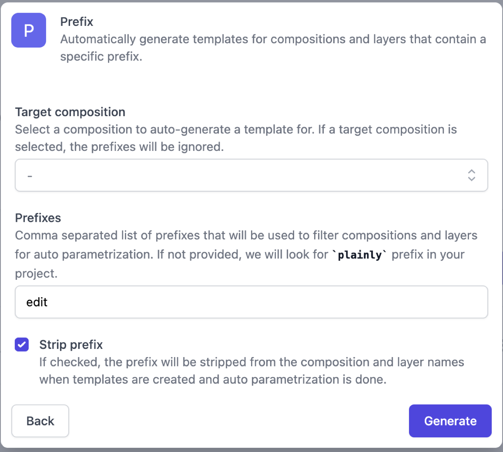
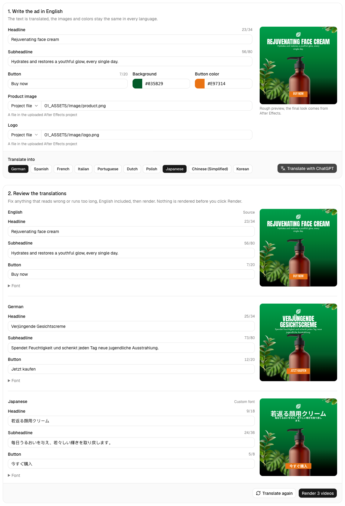
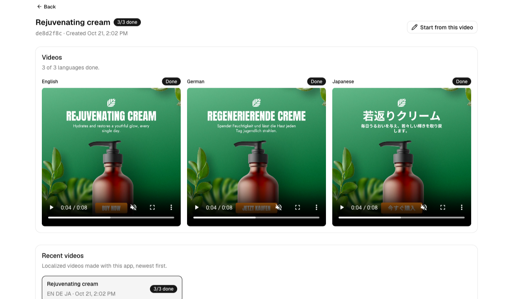

# AI localized videos example

This example demonstrates generating the same video in multiple languages with [Plainly Videos](https://www.plainlyvideos.com/), with ChatGPT translating the on-screen text automatically. You write a product ad once in English, pick the languages you want, review every translation next to a preview, and get one rendered video per language.

The template is a square product ad with a headline, a subheadline, a product image, a logo and a button on a background color of your choice. Only the text gets translated, while the images and colors stay the same in every language. Japanese, Chinese and Korean use characters the template's fonts don't include, so the app switches them to a different font at render time, without any changes to the After Effects project.

## What this app does

**Non-technical view:**
Write the headline, subheadline and button text in English, set the product image, logo and colors, and pick the languages. Click one button and ChatGPT translates the text into all of them. Each language gets a row with a live preview and its text, English included, so you can fix anything that reads wrong or runs too long before rendering. Click **Render** and you get one video per language, English included.

**Technical view:**
A TanStack Start app with two server functions doing the work. The first sends the English text to the OpenAI Responses API once, with a structured output schema that returns the headline, subheadline and button text for every language. The second sends one `POST /api/v2/renders` request per language to `https://api.plainlyvideos.com`. Languages the template fonts can't show get a font URL in the request's render `properties`. Every render is tagged with custom attributes, and the app finds them again with `POST /api/v2/renders/attributes`. No database, no webhooks and no local storage are needed.

> [!WARNING]
> Finding renders by custom attributes keeps this example short, but do not copy it into a real app. Every render in the organization can carry the same attributes, the lookup is a paginated search and older renders drop out of the results. Keep your own records instead: save each localization in your database, send its id with the render (for example as webhook `passthrough`) and update its status from webhooks, as the [Render and webhook example](../plainly-render-and-webhook/) does.

## What you'll learn

- **🌍 AI translation**: Translate the on-screen text into multiple languages with one OpenAI call that returns JSON in a fixed shape.
- **👀 Review before rendering**: Show every translation with a preview and length checks, so nothing renders until a person approves it.
- **🎬 One render per language**: Send the same template with different text in one render request per language.
- **🔤 Fonts per render**: Switch a text layer's font with render `properties`, so Japanese, Chinese and Korean render with the right glyphs.
- **🏷️ Attribute filtering**: Tag renders with your own data and query them later, to load one localization or list recent ones.

## Prerequisites

- [Node.js](https://nodejs.org/) (v24 or later, run `nvm use` to pick it up from `.nvmrc`)
- [pnpm](https://pnpm.io/) package manager (v12 or later)
- An [OpenAI API key](https://platform.openai.com/api-keys)

## Getting started

1. Clone the repository:

    ```bash
    git clone https://github.com/plainly-videos/video-automation-examples.git
    cd video-automation-examples/ai-localized-videos
    ```
2. Install dependencies:

    ```bash
    pnpm install --frozen-lockfile
    ```
3. Upload the After Effects project used in this example to Plainly Videos:
   - Download the [example project](../after-effects-projects/Localized%20Product%20Ads.zip). It has one 1080×1080 composition, `Render`.
   - Go to the [upload form](https://app.plainlyvideos.com/dashboard/projects/create) and upload the project.
   - Once the upload is done, auto-generate the template with the prefix option:
      - Leave the target composition empty.
      - Set the prefix to `edit`, which includes all compositions and layers whose names start with `edit`.
      - Check **Strip prefix**, so the layer `editHeadline` becomes the parameter `Headline`. The app sends the parameter names without the prefix.
      - Click **Generate**.

   <p align="center">
     
   </p>

   - This generates the template `Render` with the parameters `Headline`, `Subheadline`, `CTA` (text), `ProductImage`, `Logo` (image), `ColorBackground` and `ColorButton` (hex colors).

4. Set up environment variables:

    ```bash
    cp .env.example .env
    ```

    Update `.env` with your Plainly API key from [Plainly Videos settings](https://app.plainlyvideos.com/dashboard/user/settings/general), the id of the project you just uploaded, and your OpenAI API key. The template id is not needed; the app uses the project's default template.

    ```properties
    # Plainly API key, from https://app.plainlyvideos.com/dashboard/user/settings/general
    PLAINLY_API_KEY=your_plainly_api_key

    # ID of the Localized Product Ads project you uploaded to Plainly
    PLAINLY_PROJECT_ID=your_plainly_project_id

    # OpenAI API key, from https://platform.openai.com/api-keys
    OPENAI_API_KEY=your_openai_api_key
    ```
5. Start the development server:

    ```bash
    pnpm dev
    ```

    The app is available at http://localhost:3000.

## Usage

Open http://localhost:3000. Write the ad in English and watch the preview next to the form. The product image and logo default to the files inside the uploaded project, so the example works without any URLs. To use your own, switch the source next to the field from **Project file** to **URL** and paste an `https://` link. Colors can be picked or typed as `#RRGGBB`. Pick the languages and click **Translate with ChatGPT**.

Each language gets a row with its own preview and text, English first, where you can still edit it. Every field counts characters against the limit for that language, and text that is too long turns red and blocks rendering until you shorten it. ChatGPT is asked to stay within the limits but doesn't always manage, so check the counters. Japanese, Chinese and Korean come with a font already set, under **Font**, and any other language, English included, can get one there too.

<p align="center"></p>

Click **Render**. Every render costs credits, so check the previews first. The app opens `/video/<id>`, where each language turns into a video once its render is done, or shows that it failed, with the error message when Plainly gives one. Click **Start from this video** to open the form with the same English text, images, colors and languages.

<p align="center"></p>

Up to 20 of the latest localizations are listed under **Recent videos** on every page. The list comes from Plainly's attribute search, so it includes renders tagged by this example from anyone in your organization, including ones made with a copied curl.

### Translate with ChatGPT

The `translate` server function makes one call for all languages. Structured output makes the model answer with JSON that matches a Zod schema, one entry per language code, so the app never parses free text:

```ts
// ./src/lib/openai.ts
const response = await openai().responses.parse({
  model: MODEL,
  instructions: translationInstructions(languages),
  input: JSON.stringify(copy),
  text: {
    format: zodTextFormat(translationSchema(languages), "translations"),
  },
});
return parseTranslation(languages, response.output_parsed);
```

The instructions ask for ad copy rather than a literal translation, and list each language's character limits. The limits were measured on renders of the template: the headline and the subheadline each fit on two lines, longer text runs into the product. Japanese, Chinese and Korean characters are about twice as wide as Latin ones, so their limits are lower (see `src/lib/languages.ts`).

### Render one video per language

The `createLocalization` server function sends one single render request per language, with `Promise.allSettled`, so one language can fail without losing the others. Each request carries custom attributes, which is how the app finds it again. `languages` lists the whole localization, so the results page also knows about a language whose request failed:

```json
{
  "projectId": "your-project-id",
  "templateId": "your-template-id",
  "parameters": {
    "Headline": "若返りクリーム",
    "Subheadline": "毎日うるおいを与え、若々しい輝きを取り戻します。",
    "CTA": "今すぐ購入",
    "ProductImage": "(Footage)/01_ASSETS/Image/product.png",
    "Logo": "(Footage)/01_ASSETS/Image/logo.png",
    "ColorBackground": "035B29",
    "ColorButton": "E97314"
  },
  "properties": {
    "Headline": { "fontUrl": "https://raw.githubusercontent.com/google/fonts/main/ofl/notosansjp/NotoSansJP%5Bwght%5D.ttf", "font": "NotoSansJP-Bold" },
    "Subheadline": { "fontUrl": "https://raw.githubusercontent.com/google/fonts/main/ofl/notosansjp/NotoSansJP%5Bwght%5D.ttf", "font": "NotoSansJP-Bold" },
    "CTA": { "fontUrl": "https://raw.githubusercontent.com/google/fonts/main/ofl/notosansjp/NotoSansJP%5Bwght%5D.ttf", "font": "NotoSansJP-Bold" }
  },
  "attributes": {
    "example": "ai-localized-videos",
    "localizationId": "de8d2f8c-0d6b-44db-a5ff-31c38fda5e04",
    "language": "ja",
    "languages": "en,de,ja"
  }
}
```

The colors are hex digits without the `#`, because the template turns the text into a color with `hexToColor("0x" + text)`. Media parameters take a URL or a path to a file inside the uploaded project.

### Fonts for other languages

The template uses Anton, Jost and DIN Condensed. They cover the Latin languages in the list, but not Japanese, Chinese or Korean, which would render with missing glyphs. Render `properties` change a text layer's font for one render only: they are keyed like `parameters`, and `fontUrl` points to a font file that Plainly downloads while rendering.

- **Getting a font URL.** Google Fonts' own links are CSS for browsers and don't work. Use the raw `.ttf` from the [google/fonts](https://github.com/google/fonts) repository instead, like the Noto Sans links in `src/lib/languages.ts`.
- **Picking a weight.** The Noto Sans fonts are variable fonts, and without a name they render in their default weight, which is Thin. `font` is the PostScript name of the instance to use, `NotoSansJP-Bold` here. It also picks one font from a `.ttc` collection. A static font file needs no name.
- **When it fails.** A font URL that can't be downloaded fails the render with `WORKER_FONT_INSTALL_FAILED`, and a font without the glyphs for the text fails it too. The results page shows Plainly's message on that language.
- **Adding a language.** Add it to `LANGUAGES` in `src/lib/languages.ts`, with a `font` when the template fonts don't cover it. Russian and Greek, for example, need one, because Anton has no Cyrillic or Greek letters.

Each language card has a **Font** section with these two fields, so you can try another font without changing code. The preview loads the same file, so you can see the change before rendering.

### Find renders by attribute

`POST /api/v2/renders/attributes` returns the renders whose attributes match. The results page filters by `localizationId`, and the recent list filters by `example`. `sort=createdDate,desc` puts the newest renders first, so a full page leaves out the oldest ones:

```ts
// ./src/lib/plainly.ts
const query = `size=${size}&sort=createdDate,desc`;
const res = await plainlyFetch(`/renders/attributes?${query}`, {
  method: "POST",
  body: JSON.stringify({ filters: [{ key, value }] }),
});
```

While any language is still rendering, the results page calls this again every 5 seconds.

### Good to know

- The preview is made by hand for this template: its timings and layout were measured on a rendered video (see `src/components/preview-data.ts`). Plainly does not provide it, so other templates need their own preview, or none.
- Translations are not saved. Reloading the page during review loses them, and **Start from this video** translates again.
- Right-to-left languages such as Arabic and Hebrew need extra setup in After Effects and are not part of this example.
- Prefer webhooks over polling in production. See [webhook delivery](https://help.plainlyvideos.com/docs/user-guide/rendering/video-delivery#webhook-delivery) and the [Render and webhook example](../plainly-render-and-webhook/).

## Useful commands

- `pnpm dev` - Starts the app in development mode.
- `pnpm build` and `pnpm preview` - Builds the app and serves the production build.
- `pnpm test` - Runs the unit tests.
- `pnpm coverage` - Runs the unit tests with a coverage report.
- `pnpm lint` - Checks the code with Biome.
