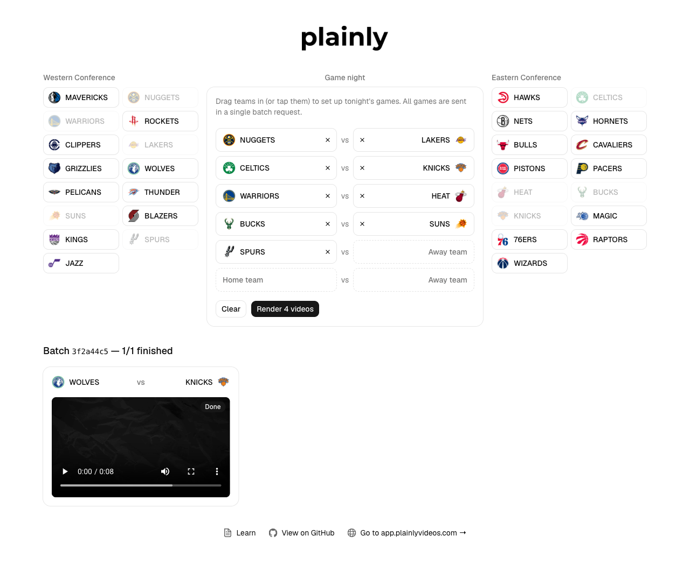

# Batch render example

This example demonstrates how to render multiple After Effects videos in a single request using the [Plainly Videos](https://www.plainlyvideos.com/) Batch Renders API.

## What this App does?

**Non-technical view:**
Drag NBA teams from the Western and Eastern Conference lists into tonight's game night, click one button, and get a matchup video for every game. Videos appear in a grid as soon as they are ready.

**Technical view:**
A TanStack Start app that sends one `POST /api/v2/batch` request to `https://api.plainlyvideos.com` containing a batch data entry per scheduled game. The batch id is kept in the URL, and the page polls `GET /api/v2/batch/{batchId}/renders` until every render is finished. No database and no webhooks are needed.

## What you'll learn

- **📦 Batch rendering**: Create many renders with a single Plainly Videos API request.
- **🏷️ Custom attributes**: Tag every render with your own data and use it to match renders back to games.
- **🔁 Polling**: Track a batch's progress without webhooks or a database.
- **🔐 Server functions**: Keep your Plainly Videos API key on the server with TanStack Start server functions.

## Prerequisites

- [Node.js](https://nodejs.org/) (v24 or later, run `nvm use` to pick it up from `.nvmrc`)
- [pnpm](https://pnpm.io/) package manager (v12 or later)

## Getting Started

1. Clone the repository:

    ```bash
    git clone https://github.com/plainly-videos/video-automation-examples.git
    cd video-automation-examples/plainly-batch-render
    ```
2. Install dependencies:

    ```bash
    pnpm install --frozen-lockfile
    ```
3. Upload the After Effects project used in this example to Plainly Videos:
   - Download the example project from [here](../after-effects-projects/Sports%20Matchup.zip).
   - Go to [Upload form](https://app.plainlyvideos.com/dashboard/projects/create) and upload the project.
   - Once the upload is done, auto-generate a template with prefix option:
      - Set the target composition to `editRender`.
      - Click on "Generate".
      - This will generate a template with few parameters from layers.

   <p align="center">
     
   </p>

4. Set up environment variables:

    ```bash
    cp .env.example .env
    ```

    Update `.env` with your API key from [Plainly Videos settings](https://app.plainlyvideos.com/dashboard/user/settings/general) and the project `ID` from the project you just uploaded.

    ```properties
    # Plainly API key, from https://app.plainlyvideos.com/dashboard/user/settings/general
    PLAINLY_API_KEY=your_plainly_api_key

    # ID of the Sports Matchup project you uploaded to Plainly
    PLAINLY_PROJECT_ID=your_plainly_project_id
    ```
5. Start the development server:

    ```bash
    pnpm dev
    ```

    The app is available at http://localhost:3000.

## Usage

Open your browser and navigate to http://localhost:3000. Drag teams from the conference lists on the left and right into the game night slots in the middle (or tap a team to put it in the next open slot). Any two teams can play each other, but every team plays only once per night. Click the button to create a batch from all complete games. The page then shows a grid with one card per game, and each card turns into a video preview once its render is finished.

The batch id is stored in the URL (`/batch/<id>`), so you can refresh the page or share the link and still see the same batch.

<p align="center"></p>

### Create a batch

A batch request has a `projectId` and a `batchData` array. Every entry in `batchData` holds the `parameters` for one render, so two games produce two renders. Each entry also carries custom `attributes`: Plainly Videos echoes them back on every render in the batch, which is how the app matches a render to its game.

Batch creation is synchronous and all-or-nothing: the API responds only after all renders are created, and if the request fails, no renders are created. The response contains the batch `id`.

The `createBatch` server function runs on the server, so your API key never reaches the browser:

```ts
// ./src/lib/plainly.ts
export const createBatch = createServerFn({ method: "POST" })
  .validator((games: { home: string; away: string }[]) => pickGames(games))
  .handler(async ({ data: games }) => {
    const projectId = process.env.PLAINLY_PROJECT_ID;
    if (!projectId) {
      throw new Error(
        "PLAINLY_PROJECT_ID is not set. Copy .env.example to .env and add your project ID.",
      );
    }

    // Batch creation is synchronous and all-or-nothing:
    // either every render is created, or none of them are
    const res = await plainlyFetch("/batch", {
      method: "POST",
      body: JSON.stringify({
        projectId,
        batchData: toBatchData(games),
      }),
    });

    if (!res.ok) {
      throw await apiError(res);
    }

    const batch: { id: string } = await res.json();
    return { id: batch.id };
  });
```

The browser only sends team ids. `pickGames` in `./src/lib/game.ts` checks them on the server (every team must exist and play only once), and each game is mapped to one batch data entry:

```ts
// ./src/lib/batch.ts
export const toBatchData = (games: Game[]) =>
  games.map(({ home, away }) => ({
    // Custom attributes come back on every render in the batch,
    // so we can tell which game a render belongs to
    attributes: { home, away },
    parameters: {
      plainlyEditTeam1: teams[home].name,
      plainlyEditLogo1: teams[home].logo,
      plainlyEditTeam2: teams[away].name,
      plainlyEditLogo2: teams[away].logo,
    },
  }));
```

For two games, the request body sent to `POST /api/v2/batch` looks like this:

```json
{
  "projectId": "your-project-id",
  "batchData": [
    {
      "attributes": { "home": "nuggets", "away": "lakers" },
      "parameters": {
        "plainlyEditTeam1": "NUGGETS",
        "plainlyEditLogo1": "https://a.espncdn.com/i/teamlogos/nba/500/den.png",
        "plainlyEditTeam2": "LAKERS",
        "plainlyEditLogo2": "https://a.espncdn.com/i/teamlogos/nba/500/lal.png"
      }
    },
    {
      "attributes": { "home": "bulls", "away": "celtics" },
      "parameters": {
        "plainlyEditTeam1": "BULLS",
        "plainlyEditLogo1": "https://a.espncdn.com/i/teamlogos/nba/500/chi.png",
        "plainlyEditTeam2": "CELTICS",
        "plainlyEditLogo2": "https://a.espncdn.com/i/teamlogos/nba/500/bos.png"
      }
    }
  ]
}
```

### Poll the batch

Once the batch is created, the app navigates to `/batch/<id>`. The route reads the batch id from the path and its loader calls `GET /api/v2/batch/{batchId}/renders`, which returns every render in the batch with its current state.

```ts
// ./src/routes/batch.$batchId.tsx
export const Route = createFileRoute("/batch/$batchId")({
  loader: ({ params }) => getBatchRenders({ data: params.batchId }),
  // ...
});
```

The `getBatchRenders` server function in `./src/lib/plainly.ts` performs the API call. While the batch is not finished, the page calls it again 5 seconds after the previous call settles. A failed poll keeps the last renders on screen and retries:

```tsx
// ./src/routes/batch.$batchId.tsx
const poll = async () => {
  try {
    const next = await getBatchRenders({ data: batchId });
    if (!active) return;
    setRenders(next);
    setPollFailed(false);
    if (isBatchFinished(next)) return;
  } catch {
    if (!active) return;
    setPollFailed(true);
  }
  timer = setTimeout(poll, POLL_INTERVAL_MS);
};
```

Polling stops when every render is in a final state, which is any state except `PENDING`, `THROTTLED`, `QUEUED` and `IN_PROGRESS`:

```ts
// ./src/lib/batch.ts
const IN_PROGRESS_STATES = ["PENDING", "THROTTLED", "QUEUED", "IN_PROGRESS"];

// Anything else (DONE, INVALID, FAILED, CANCELLED) is final
export const isFinished = (render: Pick<Render, "state">) =>
  !IN_PROGRESS_STATES.includes(render.state);

// Batch creation is synchronous, so an empty list will never fill up: stop polling
export const isBatchFinished = (renders: Pick<Render, "state">[]) =>
  renders.every(isFinished);
```

### Good to know

- Batch creation is synchronous. For large batches, increase your HTTP client timeout.
- If the request fails, no renders are created.
- For very large data sets, see the Open Batch API in the [Batch Renders API docs](https://help.plainlyvideos.com/docs/developer-guide/batch-renders-api).
- Prefer webhooks over polling in production. See [webhook delivery](https://help.plainlyvideos.com/docs/user-guide/rendering/video-delivery#webhook-delivery) and the [Render and webhook example](../plainly-render-and-webhook/).

## Useful commands

- `pnpm dev` - Starts the app in development mode.
- `pnpm build` and `pnpm preview` - Builds the app and serves the production build.
- `pnpm test` - Runs the unit tests.
- `pnpm coverage` - Runs the unit tests with a coverage report.
- `pnpm lint` - Checks the code with Biome.
