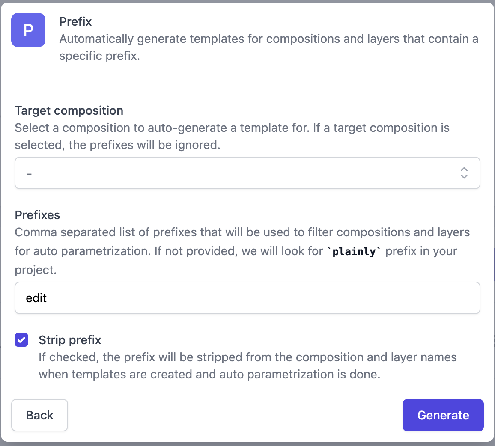
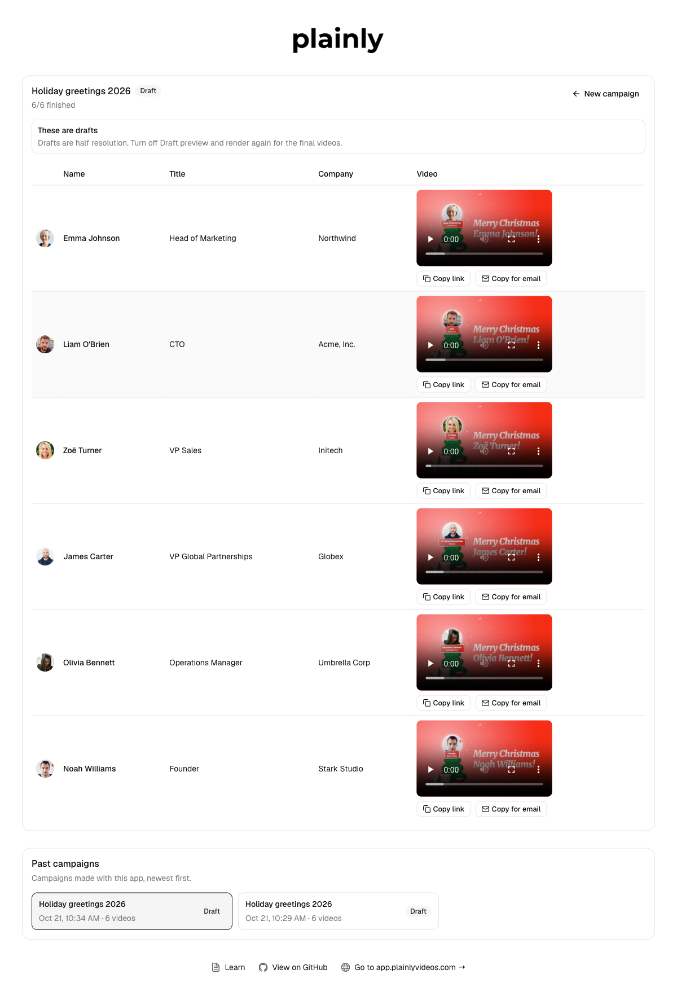
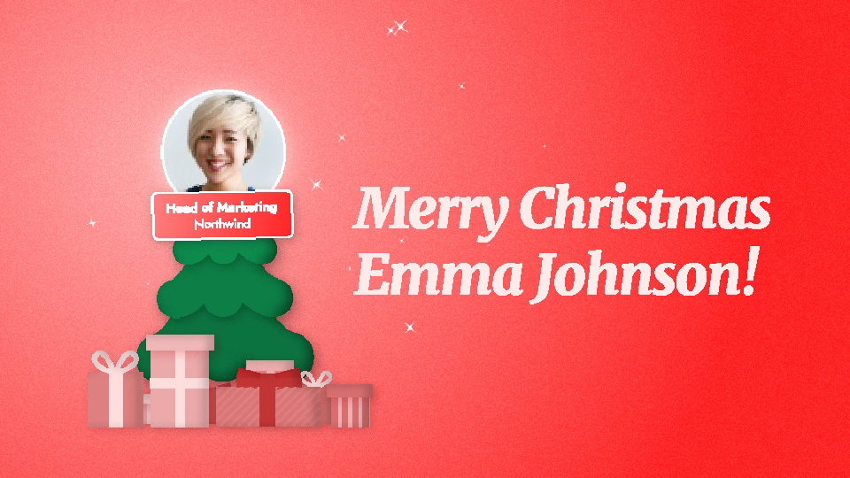

# Personalized videos example

This example demonstrates rendering a unique video per recipient with [Plainly Videos](https://www.plainlyvideos.com/), with the name, company, and other personal details filled into the same template.

The story: it's December, and a sales rep wants to thank each client with their own holiday greeting video. They upload the client list they already have as a CSV, render one video per client in one go, and paste each client's video into a Gmail message.

## What this app does

**Non-technical view:**
Drop a CSV of clients (name, job title, company and a headshot URL) onto the page. The app checks every row and marks the ones it can't use. Name the campaign, click one button, and every client gets a 7 second Christmas greeting with their face, title, company and name. Each finished video has a **Copy link** button and a **Copy for email** button, which pastes into Gmail as a clickable picture of the client's own video. Render free drafts first to check everything, then the final videos.

**Technical view:**
A TanStack Start app that parses the CSV with [papaparse](https://www.papaparse.com/), turns each valid row into one `batchData` entry, and sends a single `POST /api/v2/batch` request to `https://api.plainlyvideos.com`. Each entry sets its own file name and attributes, and the batch asks for one thumbnail per video. The app finds the renders again with `POST /api/v2/renders/attributes`, filtered by its own `example` attribute and Plainly's `batchRenderId`, and polls until they are done. No database, no webhooks and no local storage are needed.

> [!WARNING]
> Finding renders by custom attributes keeps this example short, but do not copy it into a real app. Every render in the organization can carry the same attributes, the lookup is a paginated search and older renders drop out of the results. Keep your own records instead: save each campaign and recipient in your database, send their ids with the render (for example as webhook `passthrough`) and update the status from webhooks, as the [Render and webhook example](../plainly-render-and-webhook/) does.

## What you'll learn

- **📄 CSV to batch**: Each CSV row becomes one `batchData` entry, so one Batch API request creates one render per recipient.
- **✅ Row validation before rendering**: Bad rows are shown with the reason and skipped; only good rows are sent.
- **🏷️ Per-recipient file name**: Each entry sets `attachmentFileName`, so every video saves under the client's name.
- **🖼️ Per-recipient thumbnail**: `options.thumbnails` gives every client a still of their own video, used as a clickable image in the email.
- **🆓 Free draft renders**: `settingsTemplate: DRAFT` renders at half resolution without using video minutes.
- **🎄 Campaign reference**: The batch `reference` and a `campaign` attribute name the campaign, and past campaigns are listed from Plainly.

## Prerequisites

- [Node.js](https://nodejs.org/) (v24 or later, run `nvm use` to pick it up from `.nvmrc`)
- [pnpm](https://pnpm.io/) package manager (v12 or later)

## Getting started

1. Clone the repository:

    ```bash
    git clone https://github.com/plainly-videos/video-automation-examples.git
    cd video-automation-examples/plainly-personalized-videos
    ```
2. Install dependencies:

    ```bash
    pnpm install --frozen-lockfile
    ```
3. Upload the After Effects project used in this example to Plainly Videos:
   - Download the [example project](../after-effects-projects/Christmas%20Greetings.zip). Its composition `editRender` (1920×1080, 7 seconds) has the layers `editName`, `editTitle`, `editCompany` and `editImage`.
   - Go to the [upload form](https://app.plainlyvideos.com/dashboard/projects/create) and upload the project.
   - Once the upload is done, auto-generate the templates with the prefix option:
      - Leave the target composition empty.
      - Set the prefix to `edit`, which includes all compositions and layers whose names start with `edit`.
      - Check **Strip prefix**, so the layer `editName` becomes the parameter `Name`. The app sends the parameter names without the prefix.
      - Click **Generate**.

   <p align="center">
     
   </p>

   - This generates one template, `Render`, with the parameters `Name`, `Title`, `Company` (text) and `Image` (image). It is the project's default template, so the app does not need its id.

4. Set up environment variables:

    ```bash
    cp .env.example .env
    ```

    Update `.env` with your API key from [Plainly Videos settings](https://app.plainlyvideos.com/dashboard/user/settings/general) and the id of the project you just uploaded.

    ```properties
    # Plainly API key, from https://app.plainlyvideos.com/dashboard/user/settings/general
    PLAINLY_API_KEY=your_plainly_api_key

    # ID of the Christmas Greetings project you uploaded to Plainly.
    # Its default template needs the parameters Name, Title, Company and Image
    PLAINLY_PROJECT_ID=your_plainly_project_id
    ```
5. Start the development server:

    ```bash
    pnpm dev
    ```

    The app is available at http://localhost:3000.

## Usage

Open http://localhost:3000. Drop your client list onto the upload area, pick it with the file picker, or click **Use the sample CSV**. The CSV needs these headers, in any order and any case; extra columns are ignored:

| Column | Example | Rule |
|---|---|---|
| `name` | `Emma Johnson` | Required |
| `title` | `Head of Marketing` | Required, at most 22 characters |
| `company` | `Northwind` | Required, at most 22 characters |
| `headshot` | `https://randomuser.me/api/portraits/women/44.jpg` | Required, a public `http(s)` image URL |

Files are read as UTF-8, with a fallback to Windows-1252, so a "CSV (Comma delimited)" export from Excel on Windows keeps names like `Zoë` intact.

Every row shows up in the table. Rows that break a rule are greyed out, with the reason in a red badge, and are skipped; the sample has one on purpose, a client without a headshot. The **×** at the end of a row removes it from the campaign. Up to 100 clients fit in one campaign.

Name the campaign (it also names every video file) and turn on **Draft preview (free)** for the first run. Click **Render N drafts**. The page switches to `/?batch=<id>`, and each client gets a card that turns into their video as its render finishes. A failed render shows the error reason instead. Check every face and name, then click **New campaign**, load the file again, turn off Draft preview and click **Render N videos** for the final, full resolution videos.

<p align="center"></p>

For each client, **Copy link** copies the video URL. **Copy for email** copies the client's thumbnail linked to their video, with the caption "Click the picture to watch your holiday greeting." under it; paste it into a Gmail message and the client sees a picture of their own greeting that opens the video. Plain text editors get the caption and the video link. The browser only allows copying on `https` or `localhost`, so opening the dev server by its network IP shows **Copy failed**.

<p align="center"></p>

Campaigns made with this app are listed under **Past campaigns**, newest first, so you can reopen one and copy its links again later.

### Render one video per client

The `createBatch` server function checks the input again (server functions can be called with anything), then sends one batch request. Every client becomes one `batchData` entry:

```ts
// ./src/lib/batch.ts
export function toBatchRequest(input: BatchInput, projectId: string) {
  return {
    projectId,
    // Names the batch in Plainly too
    reference: input.campaign,
    // Draft renders are half resolution and free of charge
    ...(input.draft && { outputFormat: { settingsTemplate: "DRAFT" } }),
    options: { thumbnails: { atSeconds: [THUMBNAIL_AT_SECONDS] } },
    batchData: input.recipients.map((recipient) => ({
      attachmentFileName: fileName(input.campaign, recipient.name),
      // Render responses have no parameters, so the client comes back through attributes
      attributes: { example: EXAMPLE, campaign: input.campaign, ...recipient },
      parameters: {
        Name: recipient.name,
        Title: recipient.title,
        Company: recipient.company,
        Image: recipient.headshot,
      },
    })),
  };
}
```

The request for a draft campaign of one client:

```json
{
  "projectId": "your-project-id",
  "reference": "Holiday greetings 2026",
  "outputFormat": { "settingsTemplate": "DRAFT" },
  "options": { "thumbnails": { "atSeconds": [5] } },
  "batchData": [
    {
      "attachmentFileName": "Holiday-greetings-2026-Emma-Johnson",
      "attributes": {
        "example": "personalized-videos",
        "campaign": "Holiday greetings 2026",
        "name": "Emma Johnson",
        "title": "Head of Marketing",
        "company": "Northwind",
        "headshot": "https://randomuser.me/api/portraits/women/44.jpg"
      },
      "parameters": {
        "Name": "Emma Johnson",
        "Title": "Head of Marketing",
        "Company": "Northwind",
        "Image": "https://randomuser.me/api/portraits/women/44.jpg"
      }
    }
  ]
}
```

Batch creation is all-or-nothing: either every render is created, or none of them are.

### Name each video file

`attachmentFileName` on a batch entry names that client's file, without the extension. The app builds it from the campaign and the client's name, with accents dropped and anything else turned into dashes (`Zoë Turner` becomes `Holiday-greetings-2026-Zoe-Turner`). Plainly serves the video with `Content-Disposition: inline; filename="Holiday-greetings-2026-Zoe-Turner.mp4"`, so the link still plays in the browser and saves under the client's name. `outputFormat.attachment` is not needed for this.

### Thumbnails and draft renders

`options.thumbnails.atSeconds: [5]` makes Plainly export a PNG of second 5, where the client's headshot, title, company and name are all on screen. Its URL comes back in the render's `thumbnailUris`. The app uses it as the video poster and in **Copy for email**. Plainly's storage sends no CORS headers, so the browser cannot copy the picture itself; the copied HTML points to the image URL instead.

`outputFormat.settingsTemplate: "DRAFT"` renders at half resolution and does not use video minutes. The setting comes back on every render (`outputFormat.settingsTemplate`), which is how the app marks draft campaigns.

### Find the campaign's renders

Every render is tagged with `example: "personalized-videos"`, and Plainly adds `batchRenderId` (and other `batchRender*` keys) to every batch render. `POST /api/v2/renders/attributes` returns the renders that match all filters, so one call loads a campaign:

```ts
// ./src/lib/plainly.ts
const query = `size=${size}&sort=createdDate,desc`;
const res = await plainlyFetch(`/renders/attributes?${query}`, {
  method: "POST",
  body: JSON.stringify({
    filters: [{ key: "example", value: EXAMPLE }, ...filters],
  }),
});
```

The campaign page filters by `batchRenderId` as well and calls this every 5 seconds until every render is finished. Past campaigns are the newest 1000 renders of this example, grouped by `batchRenderId`. Batches made in the Plainly app or by other tools on the same project have no `example` attribute, so they are never listed, and opening one of their ids shows **Campaign not found**.

### Good to know

- Headshots must be public URLs, because Plainly downloads them while rendering. The sample uses portraits from [randomuser.me](https://randomuser.me/).
- Video links expire. The draft renders made while building this example expired 7 days after rendering; send the links before the `expirationDate` on the render. Expired videos show as **Expired**, without copy buttons.
- The template shrinks long names to fit, but a title or company longer than one line of the badge runs into the line below. 22 characters fit, so the app rejects longer ones. A character count is only an estimate: very wide letters can still wrap.
- The thumbnail and draft settings are not specific to batches; single `POST /api/v2/renders` requests take the same `outputFormat` and `options`.
- Prefer webhooks over polling in production. See [webhook delivery](https://help.plainlyvideos.com/docs/user-guide/rendering/video-delivery#webhook-delivery) and the [Render and webhook example](../plainly-render-and-webhook/).

## Useful commands

- `pnpm dev` - Starts the app in development mode.
- `pnpm build` and `pnpm preview` - Builds the app and serves the production build.
- `pnpm test` - Runs the unit tests.
- `pnpm coverage` - Runs the unit tests with a coverage report.
- `pnpm typecheck` - Checks the types with TypeScript.
- `pnpm lint` - Checks the code with Biome. `pnpm lint:fix` applies the safe fixes.
